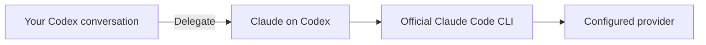

# Claude on Codex

**Bring Claude's second opinion into your Codex workflow.**

[](CHANGELOG.md)
[](#1-check-the-requirements)
[](LICENSE)

[Quick start](#quick-start) · [Workflows](#workflows) · [How it works](#how-it-works) · [Account & model](#account-and-model) · [Documentation](#documentation)

Ask Claude to review a change, challenge a design, or prepare a patch without leaving your Codex conversation. Claude on Codex delegates the task to the official Claude Code CLI and brings the result back to Codex.

**Independent community plugin · Local runtime · No runtime npm dependencies**

> **Alpha:** This project is independently developed and is not an official OpenAI or Anthropic product. See the [validation record](docs/VALIDATION.md) for tested environments and remaining release checks.

## Workflows

| You want to… | Mode | What comes back |
| --- | --- | --- |
| Get another perspective on a design | `advise` | Advice informed by read-only repository access |
| Review work before committing | `review` | Findings covering staged, unstaged, and nonignored untracked text |
| Challenge the changes on a branch | `review` + `base` | Findings for committed changes from merge-base to HEAD |
| Delegate a focused fix | `edit` | An unapplied patch from a separate Git worktree, checked against its base commit |

Jobs can run in the background. Inspect progress, retrieve results, cancel work, or resume a completed advice session by job ID. Reviews include severity, file, line, and an explanation for each finding.

## Quick start

### 1. Check the requirements

| Requirement | Details |
| --- | --- |
| **Environment** | macOS or Linux with local execution; cloud-only sessions and Windows are unsupported |
| **Runtime** | Node.js 22+ and Git |
| **Codex** | Local plugin support; installation verified with CLI `0.163.0` |
| **Claude Code** | Official CLI, authenticated and available on PATH; verified with `2.1.301` |
| **Repository** | At least one commit for review/edit; a clean repository root for edit |

The `doctor` command checks Claude CLI capabilities rather than assuming compatibility from its version. Local regression checks have passed on macOS with Node.js 22 and 24; Linux CI execution remains pending.

### 2. Install from this checkout

Open a terminal in the **claude-on-codex project root**, then run:

```sh
codex plugin marketplace add "$PWD"
codex plugin add claude-on-codex@claude-on-codex
codex plugin list
```

These commands add the local marketplace and enable the plugin in your Codex configuration.

### 3. Ask Claude from Codex

Start a new Codex conversation in the repository you want to work on. Check readiness first:

```text
$claude-on-codex:setup Check installation and authentication.
```

Then delegate a task:

```text
$claude-on-codex:delegate Review my current changes.
```

Setup checks make no model request. Delegated tasks use the account and provider configured for Claude Code and consume its usage.

<details>
<summary><strong>More examples: advice, branch review, and isolated edits</strong></summary>

**Get a second opinion**

```text
$claude-on-codex:delegate Ask Claude to assess this design and explain its tradeoffs.
```

**Review a branch critically**

```text
$claude-on-codex:delegate Critically review my committed changes since main.
```

A branch review excludes uncommitted work. Ask for a current-changes review to cover staged, unstaged, and untracked changes.

**Prepare a focused patch**

```text
$claude-on-codex:delegate Fix empty-input handling in src/parser.ts in a separate worktree.
```

Codex supplies the explicit allowed paths. The result includes a patch and its worktree location; review and test the patch before applying it.

</details>

**Updating a local installation:** update the checkout, repeat the install commands, and start a new session. Codex runs a cached copy, so editing this checkout alone does not update an installed plugin. See [troubleshooting](docs/TROUBLESHOOTING.md) if the skills are missing.

## How it works



Codex selects the task and context. The plugin starts a local worker, tracks the job, and returns advice, structured findings, or an edit patch to the conversation. Authentication stays with the official Claude CLI.

| Mode | Claude's access | Scope |
| --- | --- | --- |
| **Advice** | Read, Glob, Grep | Read-only repository context; explicit job-based resume |
| **Review** | Supplied diff only; no file or shell tools | Complete supported text changes in the requested scope |
| **Edit** | Read, Glob, Grep, Edit, Write | Detached worktree; changed paths checked after completion |

Review input is rejected if it contains unsupported binary/submodule changes or exceeds size limits. An empty findings list covers the supplied snapshot; it does not certify the whole repository.

Edits do not run tests or shell commands, and patches are never applied automatically. A patch is checked for applicability to its recorded base commit, not for correct behavior. A worktree is not an OS security sandbox; use trusted local repositories.

## Account and model

| Question | Answer |
| --- | --- |
| **Which account does it use?** | The official Claude CLI's existing login or supported authentication environment. The plugin does not create another account or extract credentials. |
| **Which model does it use?** | An explicit request's `model`, or the CLI's default under this invocation's restrictions. No model is forced by the plugin. |
| **Can I see the actual model?** | Completed jobs include `requestedModel` and CLI-reported model identifiers in `models`. An empty list means the identifiers were not reported. |
| **How is usage charged?** | Usage follows the configured Claude account/provider. `costUsd` is the CLI's estimate, not a guarantee of the amount billed. |
| **Does my code stay on this computer?** | The helper runs locally; selected prompts and source go to the provider configured for the CLI. The plugin has no separate hosted service or telemetry. |

A model selected in a separate interactive Claude session may not apply here: restricted-mode settings and the environment allowlist affect the invocation. See [authentication and model selection](docs/AUTHENTICATION.md) for the exact behavior.

## Direct CLI

The same runtime can be used from scripts. From the project root:

```sh
COMPANION="$PWD/plugins/claude-on-codex/scripts/companion.mjs"
node "$COMPANION" doctor
```

For a background review, replace `/absolute/repository` with the target repository's absolute path:

```sh
node "$COMPANION" start <<'CLAUDE_REQUEST'
{"workspace":"/absolute/repository","mode":"review","background":true}
CLAUDE_REQUEST
```

Use the returned `id` to manage the job:

```sh
node "$COMPANION" status --workspace /absolute/repository --job JOB_UUID
node "$COMPANION" result --workspace /absolute/repository --job JOB_UUID
node "$COMPANION" cancel --workspace /absolute/repository --job JOB_UUID
```

`list --workspace /absolute/repository` discovers retained jobs. Requests support `model`, `effort`, `maxTurns`, `timeoutMs`, and `maxBudgetUsd`; see the [CLI reference](docs/INTERFACE.md) for limits, JSON examples, and status semantics.

<details>
<summary><strong>Local records and cleanup</strong></summary>

Job records, prompts, diagnostics, and patches are retained under `~/.codex/claude-on-codex/` until explicitly removed. They may contain source code. `CLAUDE_ON_CODEX_HOME` can select another state directory.

Save any patch you need before deleting a finished job:

```sh
node "$COMPANION" cleanup --workspace /absolute/repository --job JOB_UUID --discard true
```

This permanently deletes the job's records and edit worktree. Cleanup refuses active or interrupted jobs, live recorded processes, and session-lock conflicts. Claude's own session history is separate and is not deleted. See [security and data handling](SECURITY.md).

</details>

## Development and verification

No `npm install` is required. Development checks use a mock Claude CLI and do not make model requests.

| Command | Purpose | Additional requirement |
| --- | --- | --- |
| `npm run setup:hooks` | Enable the staged-document commit check | Git checkout |
| `npm run check` | Regression tests, manifests, syntax, and English documentation | `zip`, `unzip` for archive tests |
| `npm run test:install` | Install and discover both skills in a temporary Codex configuration | Codex CLI |
| `npm run test:artifacts` | Extract and verify the source and standalone plugin ZIPs | Codex CLI, `zip`, `unzip` |
| `npm run pack:plugin` | Build both ZIPs and SHA-256 sidecars in `dist/` | `zip` |

The recorded local baseline is **32 passing tests on Node.js 22 and 24 on macOS**, including patch, submodule, authentication, cancellation, and distribution regressions. Workflow configuration also covers Linux; a passing remote CI run is still a release prerequisite. Read the [validation evidence](docs/VALIDATION.md) for the distinction between mock, installation, and live-provider checks.

Real-provider smoke tests are opt-in and consume usage. See [testing](docs/TESTING.md) before running them.

Contributions are welcome. Public documentation is written in English; personal or Korean notes belong in the ignored `.local-notes/` directory and are excluded from releases. See [CONTRIBUTING.md](CONTRIBUTING.md).

## Documentation

| Guide | Covers |
| --- | --- |
| [Architecture](docs/ARCHITECTURE.md) | Components, data flow, and process lifetime |
| [CLI reference](docs/INTERFACE.md) | Commands, request fields, results, and limits |
| [Authentication and models](docs/AUTHENTICATION.md) | Account selection, environment forwarding, and model reporting |
| [Troubleshooting](docs/TROUBLESHOOTING.md) | Missing skills, authentication errors, failed edits, and interrupted jobs |
| [Security](SECURITY.md) | Trust boundaries, data retention, and vulnerability reporting |
| [Testing and evidence](docs/TESTING.md) · [Validation record](docs/VALIDATION.md) | Reproducible checks and their actual results |
| [Improvement plan](docs/IMPROVEMENT_PLAN.md) · [Release process](docs/RELEASE.md) | Completed hardening work and remaining publication gates |
| [Changelog](CHANGELOG.md) | User-visible changes and compatibility notes |

## License and acknowledgments

[MIT](LICENSE). See [NOTICE.md](NOTICE.md) for attribution and independent-project status.

The reverse-direction integration was informed by [OpenAI's Codex plugin for Claude Code](https://github.com/openai/codex-plugin-cc); this runtime is independently implemented. README organization draws inspiration from [oh-my-claudecode](https://github.com/Yeachan-Heo/oh-my-claudecode) and [Strata](https://github.com/Niko1221/Strata). These references do not imply affiliation or endorsement. Further technical sources are listed in [design references](docs/RESEARCH.md).
