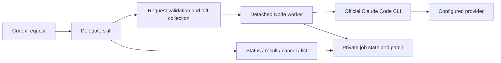

# Architecture

## Execution flow

The portable plugin contains its entire runtime. Skills resolve `scripts/companion.mjs` relative to their installed location, so execution does not depend on the user's current directory.

## Modules

| Module | Responsibility |
| --- | --- |
| `core.mjs` | Request validation, canonical paths, environment allowlist, private atomic state |
| `git.mjs` | Complete review collection, clean edit worktrees, path checks, patch verification |
| `claude.mjs` | CLI feature/authentication diagnosis, argument construction, result parsing |
| `jobs.mjs` | Detached workers, explicit session identity, timeouts, cancellation |
| `retention.mjs` | Metadata listing and guarded deletion of finished jobs |
| `companion.mjs` | JSON command-line interface |

## Reliability boundaries

Workers are the sole writers of job state after launch. Atomic replacement prevents partial JSON reads. Session directory locks reject overlapping resumes. Requests are sent over stdin rather than command arguments, and subprocesses run without a shell.

Review collection reads the diff twice and compares content and revision metadata. This detects many concurrent changes but does not lock the repository into an atomic snapshot. Submodules and binary review changes are explicitly rejected. Git color and path-prefix settings are overridden; external diff, text conversion, hooks, and filesystem monitors are disabled for plugin Git commands.

Edit mode starts from a clean repository in a detached worktree. Post-edit checks cover tracked and ignored/untracked additions, allowed paths, symlinks, and the base commit. A temporary Git index verifies the resulting patch against that commit without changing either real index. This is an applicability check, not a behavior test. The original checkout may have changed since the job started; check application again before applying.

## Process lifetime

The worker owns the Claude process group. Cancellation requests cause SIGTERM, then SIGKILL if needed, followed by termination checks. The controller never signals a PID taken from an old job file. A lost worker becomes `interrupted`; the plugin cannot guarantee descendant termination after abrupt worker death.

Cleanup requires an explicit discard option, a finished non-interrupted job, no live recorded worker/process group, and an acquired session lock. It removes an edit worktree through Git before deleting job data. It does not erase Claude's separate session history.

## Trust model

Worktrees, file tool restrictions, and thread IDs are not OS security boundaries. The plugin is intended for trusted local repositories under the same OS account. Managed Claude policies still apply. Repository contents and model output remain untrusted suggestions. See [SECURITY.md](../SECURITY.md) for data flow and limitations.
